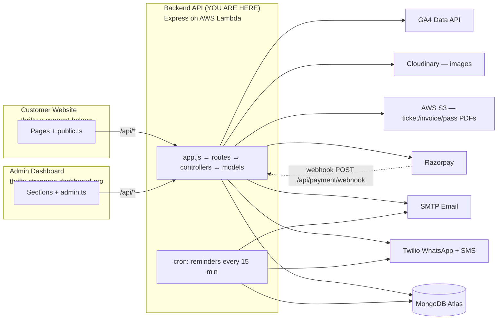
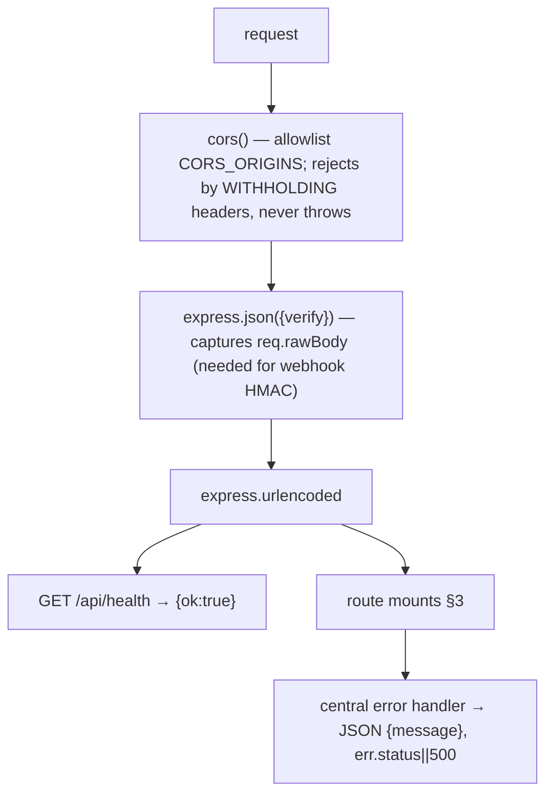
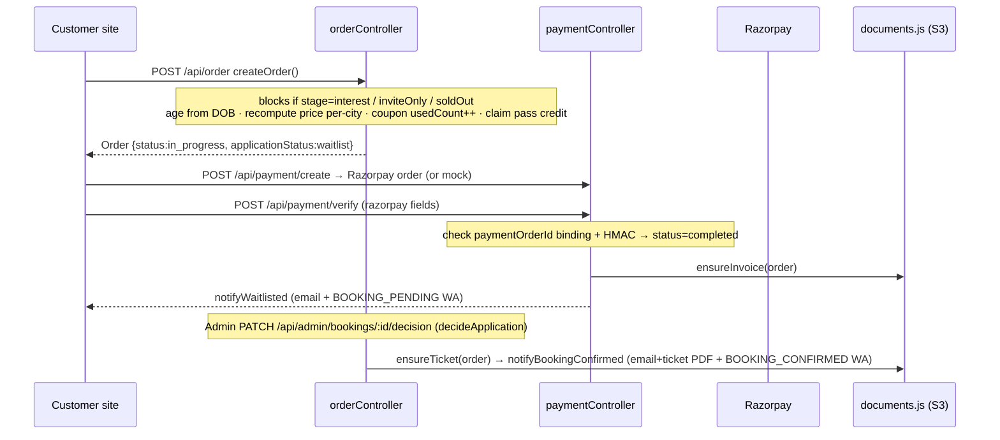
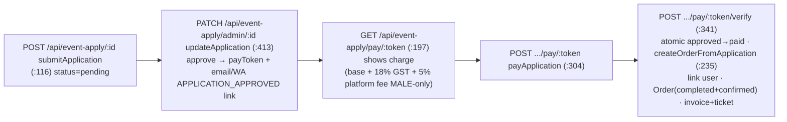

# Backend — Architecture & Bug-Location Guide

> **What is this?** A developer map of the **IRL Social Hive backend** (`thriftyx-serverless-backend/backend`) — Express on AWS Lambda + MongoDB. This is where **most bugs actually live** (both frontends just call these endpoints). New here? Read §1 (system), §2 (how a request enters), §3 (the route→controller index — your main lookup), then the flow in §5, and keep §8 ("Where does this bug live?") handy.
>
> **Sister docs:** customer site → `thrifty-x-connect-belong/ARCHITECTURE.md` · admin → `thrifty-strangers-dashboard-pro/ARCHITECTURE.md`
>
> **Stack:** Express via `serverless-http` on AWS Lambda · Mongoose/MongoDB Atlas · Serverless Framework **v3** (deploy with `npx serverless@3`, local `node_modules` is v4 and errors on `frameworkVersion:'3'`).

---

## 1. The whole system (3 apps + external services)

---

## 2. How a request enters (entrypoints)

### `handler.js` — the 3 Lambda functions
| Export | Trigger | Does |
|---|---|---|
| `api` | HTTP API `*` | `serverless(app)` — the whole Express app |
| `reminders` | `schedule: rate(15 minutes)` | `connectDB()` → `reminderController.sendDueReminders()` (24h/3h/1h bands) → `orderController.cleanupExpiredManualAttendees()` |
| `eventReminder` | one-off `cron(30 3 29 10 ? 2026)` | `eventReminderCore.cjs` nudge — **remove after it runs** |

### `app.js` — middleware order (this order matters for bugs)

> ⚠️ A failed CORS check returns **no headers** (not a 500). So if the browser reports "CORS error", the real cause is often a backend **500** with no CORS headers added — check CloudWatch logs, not the CORS list.

### `config/db.js` — `connectDB()`
Module-cached connection. Target chosen by `utils/runtimeEnv.isDeployed`: **deployed → `MONGO_URI` (PROD); local → `MONGO_URI_DEV`** (falls back to `MONGO_URI`). Every route file lazy-calls `connectDB()` per cold start. Logs host/db and flags `⚠️ PRODUCTION`.

### `serverless.yml`
`service: thriftyx-backend`, runtime `nodejs20.x`, region `ap-south-1`, `timeout:29` (API Gateway cap — long jobs stream to S3 + return URLs), `httpApi.cors:false` (Express owns CORS). IAM grants S3 read/write on `${S3_BUCKET}`. `useDotenv:true` loads `.env` at deploy. Package **keeps `node_modules`** (pdfkit `.afm` fonts must ship — do **not** add esbuild). `GA_SA_CREDENTIALS` is NOT an env var (too big) — bundled as `ga-sa-credentials.json`.

---

## 3. Route → controller index (your main "where to look")

**Auth guards:** `protect` = admin JWT→`req.admin`; `isSuperAdmin`; `requireModule(mod,level)` = super-admin OR sub-admin permission ≥ level. `protectUser` = customer JWT→`req.user`; `optionalUser` = guest-OK soft auth. (`roleMiddleware.checkPermission` exists but is unused.)

| Base path | Route file | Controller | Guard |
|---|---|---|---|
| `/api` (faq, gallery, founders, stats, **leads**) | `publicRoutes.js` | faq/gallery/founder/stats/lead | none |
| `/api/auth` | `authRoutes.js` | `authController.js` | none (issues JWTs) |
| `/api/events` | `eventRoutes.js` | `eventController.js` | public read / `protect` write / `protectUser` interest+wishlist |
| `/api/order` | `orderRoutes.js` | `orderController.js` | `protectUser` |
| `/api/payment` | `paymentRoutes.js` | `paymentController.js` + `webhookController.js` | create/verify `protectUser`; **webhook none (HMAC)** |
| `/api/cart` | `cartRoutes.js` | `cartController.js` | none (anonymous until order) |
| `/api/coupon` | `couponRoutes.js` | `couponController.js` | `optionalUser` |
| `/api/membership` | `membershipRoutes.js` | `membershipController.js` | `/plan` public, rest `protectUser` |
| `/api/event-apply` | `eventApplicationRoutes.js` | `eventApplicationController.js` | public (pay by token) + `protect` (admin) |
| `/api/trips` | `tripRoutes.js` | `tripController.js` | public + `protect` (admin) |
| `/api/series` | `seriesRoutes.js` | `seriesController.js` | public read + `protectUser` buy + `protect` admin |
| `/api/user` | `userRoutes.js` | **`profileController.js`** (me-scoped) | `protectUser` |
| `/api/uploads` | `uploadRoutes.js` | `uploadController.js` | image sig public, video sig `protectUser` |
| `/api/admin` | `adminRoutes.js` | many (`router.use(connectDB, protect)`) | admin; finance `requireModule`; campaigns `isSuperAdmin` |
| `/api/subadmin` | `subAdminRoutes.js` | `subAdminController.js` | `protect`+`isSuperAdmin` |
| `/api/support` | `supportRoutes.js` | `supportController.js` | none |
| `/api/rating` + `/api/ratring` (legacy typo) | `ratingRoutes.js` | `ratingController.js` (Review) | ⚠️ none |
| `/api/reviews` | `reviewRoutes.js` | `reviewController.js` | ⚠️ none |
| `/api/story` | `storyRoutes.js` | `storyController.js` | ⚠️ none |

**High-traffic endpoints** (full tables in the flows below):
- `GET /api/events` `getEvents` — public returns **upcoming only, strips `-instruction -description`** to stay under the 29s/6MB Lambda cap; admin path (`/api/admin/events`) returns all + sales rollups.
- `POST /api/order` `createOrder` — the booking brain (pricing, coupon, age-gate, pass).
- `POST /api/payment/verify` + `POST /api/payment/webhook` — the two ways a payment confirms.
- `/api/order/:id/{cancel,reschedule,change-city,refund-status,ticket-pdf,invoice-pdf}`.
- `/api/event-apply/*` — invite-only apply→approve→pay.
- `/api/admin/*` — the entire admin surface (events/attendees/bookings/finance/campaigns/analytics/memberships…).

---

## 4. Models (`models/`) — the data shapes that cause most confusion

| Model (collection) | Load-bearing fields |
|---|---|
| **`orderModel.js`** (`order`) | **TWO status fields:** `status` = **money** (`pending/in_progress/completed/failed/cancelled`); `applicationStatus` = **curation** (`waitlist/confirmed/rejected`). A live attendee needs **`completed` + `confirmed` + `refund.id:null`**. Also `paymentOrderId` (binds Razorpay order), `payment_id`, totals (`grand_total/total_price/booking_fee/gst/discount/coupon_code`), **`event_city`** (which city of a multi-city event), `attendee_details` (booker/invoice) + `attendees[]` (one QR + check-in each), `membership_id`+`paidByPass`+`passSeat`, `addedByAdmin` (placeholder/manual — excluded from revenue), `seriesId/seriesOrderId`, `ticket_url/invoice_url/invoice_no`, `refund{id,status,amount,rrn}`, `reminders{h24,h3,h1}`, `checkedIn`. |
| **`EventModel.js`** (`events`) | `locations[]` = **per-city** `{venue,address,lat,lng,date,start_time,end_time,tickets[]}` (per-city inventory + schedule override); top-level `date/tickets` = fallback. `seriesKey` (reschedule-between-same-series), `stage` (`open`/`interest`), `inviteOnly`, **`soldOut` (the ONLY flag that blocks booking)**, `status` (`Published`/`Unpublished`), `checkoutQuestions[]`, `min_age/max_age`, `cardImage`, `videoUrl/videoEnabled`. |
| `EventApplicationModel.js` (`eventApplication`) | invite-only app. `status` `pending/approved/rejected/paid`, **`payToken`** (login-free pay), `order_id` (confirmed Order made on pay), `amount/ticketName`. |
| `userModel.js` (`users`) | phone/email/DOB/gender/city, `otp`, `pendingEmail/pendingPhone/contactOtp` (OTP-gated change), `notificationPreferences`. |
| `adminModel.js` (`Admin`) | `role` `SUPER_ADMIN/SUB_ADMIN`, `permissions[{module,access}]`. |
| `membershipModel.js` (`membership`) | Golden Pass. `status` `pending/active/expired/cancelled`, `eventsTotal/eventsUsed` (+`eventsRemaining`), `expiresAt`, `memberId`, `isUsable()`. |
| `TripModel.js` / `TripRegistrationModel.js` | trip + join request (`requested/accepted/rejected/paid`, `payToken`, admin-set `amount`). |
| `SeriesModel.js` / `SeriesOrderModel.js` | curated set + one purchase → `childOrderIds[]` (N bookings). |
| `couponModel.js` (`Coupon`) | `discountType` `percent/flat/bogo`, `usageLimit/perUserLimit/usedCount` (**source of truth, incremented atomically in createOrder**), `audience`, `genders/cities`, `assignedTo`. |
| `leadModel.js` (`lead`) | abandoned checkout; `status` `abandoned/converted`; dedup by (event + email/phone). |
| `financeEntryModel.js` | manual P&L row (`income/expense`). **Website revenue is NOT stored here** — computed live from orders. |
| `campaignSendModel.js` | per-(campaign,phone) WA log; **unique `{campaign,phone}` = dedupe**. |
| `eventEngagementModel.js` / `eventInterestModel.js` | wishlist (login-gated, unique) + share (anon) / "interested" on coming-soon. |
| `counterModel.js` (`counter`) | `Counter.next(key)` — gap-free invoice numbers + member ids. |
| `cartModel.js` | pre-checkout line. |
| `storyModel`/`reviewModel`/`faqModel`/`supportModel`/`galleryModel`/`founderModel` | content/support. |

---

## 5. Key flows (with file:line)

### (a) Direct booking → paid → confirmed

Files: `createOrder` `orderController.js:206` · `createPayment` `paymentController.js:101` · `verifyPayment` `:169` · `decideApplication` `orderController.js:950` · `notifyBookingConfirmed` `orderController.js:37`. Pass-covered-solo / ₹0 bookings skip straight to `completed`+`confirmed` inside `createOrder`.

### (b) Razorpay webhook (authoritative fallback when /verify is missed)
`POST /api/payment/webhook` → `webhookController.razorpayWebhook` (`webhookController.js:20`). Verifies HMAC of **`req.rawBody`** vs `RAZORPAY_WEBHOOK_SECRET`. On `payment.captured`/`order.paid`, tries first-match by `paymentOrderId`:
`finalizeOrderPaid` (`paymentController.js:366`) → `finalizeApplicationPaid` (`eventApplicationController.js:560`) → `finalizeTripPaid` (`tripController.js:443`). Each idempotent + status-guarded. **Always returns 200** (no retry-storm). ⚠️ **Golden Pass & series have NO webhook finalizer** — they rely only on their own `/verify`.

### (c) Invite-only: apply → approve → pay → booking

Webhook equivalent: `finalizeApplicationPaid`. `createOrderFromApplication` dedupes on `payment_id` and links/creates the user via `userLink.findOrCreateUserForAttendee` (so login-free bookings show in "My Tickets").

### (d) Reschedule — `orderController.rescheduleOrder` (`:1481`)
Only `completed`, not rejected, not checked-in, different event. **Invite-only target allowed ONLY if same `seriesKey` AND attendee is `completed`+`confirmed`** (`:1511`). Dearer → Razorpay diff; cheaper → partial refund. Moves `event_id`, resets check-in, **nulls `ticket_url/invoice_url/invoice_no`** so docs regenerate.

### (e) Refund / cancel
- **Self-cancel** `PATCH /api/order/:id/cancel` → `cancelOrder` (`:611`): blocked after check-in; returns pass credit; **tiered refund by hours-to-event: ≥48h→100%, 24–48h→50%, <24h→10%, started→0%**; emails + `BOOKING_CANCELLED` WA.
- **Admin refund** `PATCH /api/admin/bookings/:id/refund` → `refundBooking` (`:1644`): idempotent (refuses if `refund.id` set); full refund + credit + `status=cancelled` + `REFUND` WA.
- **Status** `getRefundStatus` (`:1034`) re-queries Razorpay for the RRN.

### (f) OTP auth
`POST /api/auth/start` → `start` (`authController.js:559`): normalises identifier (`toE164`), `findUserByIdentifier` (tries all phone shapes), `generateOtp(4)`, existing → `otpType:login` / new → creates unverified User + `otpType:register`, delivers (WhatsApp if phone else email), **never returns the code**. `POST /api/auth/verify-code` → `verifyCode` (`:197`): checks `user.otp`, issues `jwtGenerator({_id})` (24h). OTP mandatory on every login/signup.

### (g) Reminders cron + cleanup
`handler.reminders` (15 min) → `reminderController.sendDueReminders` (`reminderController.js:48`): per confirmed/paid/non-refunded order, `eventStart(ev, order.event_city)` → band `h24 (3–24h) / h3 (1–3h) / h1 (0–1h)`, idempotent on `order.reminders.{band}`, sends `EVENT_REMINDER` WA + email, cap 400/run. Then `cleanupExpiredManualAttendees` (`orderController.js:1214`) deletes `addedByAdmin` orders the day after their (per-city) date.

### (h) Trips / (i) Golden Pass / (k) Finance (brief)
- **Trips**: request → admin accept(+amount) → `payToken` link (`TRIP_ACCEPTED` WA) → pay/verify → registration `paid` (no Order created). Webhook `finalizeTripPaid`.
- **Golden Pass**: `/plan` public pricing; `purchaseMembership` (`:204`) pending pass + `memberId`; `verifyMembership` (`:273`) → active + pass/invoice PDFs; `consumeCredit`/`refundCredit` on booking/cancel.
- **Finance P&L**: `financeSummary` (`financeController.js:166`) = live website revenue from `Order` (completed, not refunded, not addedByAdmin) **+** manual `FinanceEntry` rows; reconcile matches bank CSV lines.

---

## 6. Utils / services (`utils/`) — the shared machinery

| File | Role |
|---|---|
| **`runtimeEnv.js`** | `isDeployed = Boolean(AWS_LAMBDA_FUNCTION_NAME)` — **the single prod-vs-local switch.** Drives DB choice, forces Razorpay test mode locally, and the send-redirect. `DEV_NOTIFY_EMAIL`/`DEV_NOTIFY_PHONE`. |
| `twilioClient.js` | shared Twilio client (env-gated `isConfigured`). |
| `sendMessage.js` | `sendWhatsapp` (free-form/OTP), **`sendWhatsappTemplate(phone,sid,vars)`** (approved template path), `sendSMS`. **Local → redirects to `DEV_NOTIFY_PHONE`.** |
| `sendMail.js` | `sendMail(to,subject,msg,attachments)` SMTP; HTML-detects body → sets `html`+plain-text fallback; streams S3 PDF attachments. **Local → redirects all mail to `DEV_NOTIFY_EMAIL`.** |
| `notify.js` | `notifyOrder` (email-only), `notifyUser`, **`sendWaTemplate(phone,sidEnvKey,vars)`** (used everywhere for booking WA), `niceDate`, `firstName`. |
| `otp.js` | `generateOtp`, `sendOtpToEmail`, `sendMessageToWhatsapp`. Local → logs code + redirects. |
| `phone.js` | `toE164` (country 91; handles bare-10 & prefixed), `toWhatsAppAddress`. |
| `tickets.js` | **Per-city resolution — critical.** `findTicket`/`ticketsForCity`, `locationForCity`, **`orderCityVenue(order)`**, **`whenForCity(event,city)`** (effective date/time, city override → top-level). |
| `documents.js` | **Lazy, idempotent PDFs.** `ensureTicket` (only `completed`+`confirmed`; one QR page/attendee via `ticketToken.signTicket`; S3 `tickets/`), `ensureInvoice` (skips ₹0/pass; gap-free `invoice_no` via `Counter`; S3 `invoices/`). Never throws into payment. |
| `ticketToken.js` | signed-JWT QR payload (valid ~2 days past event); verified by `verifyTicketScan`. |
| `s3.js` | S3 v3 (`uploadBuffer/deleteByUrl/listObjects`). Lambda uses role creds; local uses `AWS_*`. Bucket `thriftyx-all-document`. |
| `cloudinary.js` | event/story/founder images + direct-upload signatures. |
| `userLink.js` | `findOrCreateUserForAttendee` + `myOrdersFilter` (login-free bookings surface in profile). |
| `jwt.js` / `config/gst.js` | tokens / GST config (`enabled` only when GST_ENABLED + a GSTIN; else "Payment Receipt"; CGST/SGST vs IGST via `stateForCity`). |

**Send path:** controller → `notify.sendWaTemplate(phone, SID_ENV_KEY, vars)` → `sendMessage.sendWhatsappTemplate` → `twilioClient`; email → `sendMail`. The local→prod guard (keyed on `isDeployed`) lives in each send util — **real users are never messaged from a local run.**

---

## 7. External services & env

| Service | Where | Key env |
|---|---|---|
| MongoDB | `config/db.js` | `MONGO_URI` (prod), `MONGO_URI_DEV` (local) |
| Razorpay (mock/test/live) | `paymentController.js`, `webhookController.js` | `PAYMENTS_MODE` (forced `test` when local), `RAZORPAY_*`, `RAZORPAY_WEBHOOK_SECRET` |
| Twilio WA+SMS | `twilioClient`→`sendMessage`/`otp`/`notify.sendWaTemplate` | `TWILIO_ACCOUNT_SID/AUTH_TOKEN`, `..._FROM`, template SIDs: `TWILIO_WA_BOOKING_PENDING/CONFIRMED/CANCELLED_SID`, `..._REFUND/EVENT_UPDATED/EVENT_REMINDER_SID`, `..._APPLICATION_APPROVED_SID`, `..._TRIP_ACCEPTED_SID`, `..._BOOKING_REMINDER_SID` (one-off), marketing SIDs |
| SMTP email | `sendMail.js`, `otp.js` | `SMTP_HOST/PORT/SECURE/USER/PASS`, `MAIL_FROM`, `DEV_NOTIFY_EMAIL/PHONE` |
| AWS S3 (PDFs + gallery) | `s3.js` ← `documents.js`, membership, gallery | `S3_BUCKET`, `S3_BASE_URL`, `AWS_REGION` |
| Cloudinary (images) | `cloudinary.js`, `uploadController` | `CLOUD_NAME/API_KEY/API_SECRET` |
| GA4 (admin traffic) | `webTrafficController.js` | `GA_PROPERTY_ID` + bundled `ga-sa-credentials.json` |
| Google OAuth (sign-in) | `authController.googleLogin` | `GOOGLE_CLIENT_ID` |
| GST invoicing | `config/gst.js` | `GST_ENABLED/RATE`, `SELLER_*`, `SAC_*` |

---

## 8. 🐞 "Where does this bug live?" — start here

| Symptom | Look here |
|---|---|
| Frontend reports "CORS error" | usually a backend **500** (no CORS headers added) — check CloudWatch logs for that route; CORS list is in `app.js` |
| Booking blocked unexpectedly | `orderController.createOrder` (`:206`) — only `event.soldOut`, `inviteOnly`, or `stage==='interest'` block; inventory numbers are display-only |
| Price / fee / GST wrong | `createOrder` recompute (per-city `findTicket`, fee 5% + GST 18% on discounted net); invoice split in `config/gst.js` |
| Coupon not applying / over-used | `couponController.evaluateCoupon`; `usedCount` increment is in `createOrder` (atomic) |
| Paid but booking not confirmed | `paymentController.verifyPayment` (`:169`) AND the **webhook** `webhookController.razorpayWebhook` (`:20`) + `finalizeOrderPaid` (`:366`) |
| Payment "succeeded" but nothing happened (Pass/Series) | those have **no webhook** — only `/membership/verify` or `/series/verify`; a missed client callback leaves them pending |
| Ticket/invoice PDF missing | `documents.js` `ensureTicket`/`ensureInvoice` — only generate on `completed`+`confirmed`; check `s3.isConfigured` + S3 perms |
| Wrong city/date/venue on ticket/email/reminder | a caller bypassed `tickets.whenForCity`/`orderCityVenue`/`findTicket` and used top-level fields |
| Reschedule rejected | `rescheduleOrder` (`:1481`) — invite-only needs matching `seriesKey` + `completed`+`confirmed` |
| Refund amount wrong | `cancelOrder` tiered logic (`:611`) / `refundBooking` (`:1644`); live status via `getRefundStatus` |
| OTP not delivered | `authController.start`/`deliverOtp`; `otp.js`; Twilio/SMTP config; **local run redirects to DEV_NOTIFY** |
| WhatsApp/email not sent to real users | check `runtimeEnv.isDeployed` — a **local** run always redirects to `DEV_NOTIFY_*`; real sends only on Lambda |
| Reminders not firing | `reminderController.sendDueReminders` (`:48`) band logic + `order.reminders.{band}` idempotency; the `reminders` cron |
| `/api/events` 500 / looks like CORS | payload cap — public `getEvents` must stay under 29s/6MB; it strips `-instruction -description` for the list |
| Admin section 403 | `adminRoutes.js` guards (`protect`/`isSuperAdmin`/`requireModule`); finance needs the `finance` module |
| "My Tickets" missing a login-free booking | `userLink.myOrdersFilter` / `findOrCreateUserForAttendee` matching |
| Manual/placeholder attendees vanished | `cleanupExpiredManualAttendees` deletes `addedByAdmin` orders the day after the event |
| Deploy fails "No version found for 3" | local `node_modules` serverless is v4 — deploy with **`npx serverless@3 deploy --stage prod`** |

> **Two-status rule to remember:** `Order.status` = money, `Order.applicationStatus` = curation. A confirmed, visible, reminder-eligible attendee = `status:"completed"` **and** `applicationStatus:"confirmed"` **and** `refund.id:null`. Most "attendee missing / reminder not sent / revenue wrong" bugs trace back to this pair.
